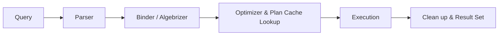

# 🗄️ SQL Fundamental Queries

> A structured journey through SQL query writing, aggregations, joins, subqueries, and set operations — across two real-world databases, with well-commented, readable solutions.

[](https://en.wikipedia.org/wiki/SQL)
[](https://www.microsoft.com/en-us/sql-server)
[](https://github.com/YahYa-mzn/SQL-Fundamental-Queries)
[](https://github.com/YahYa-mzn/SQL-Fundamental-Queries)
[](https://github.com/YahYa-mzn/SQL-Fundamental-Queries)

---

## 🔍 Quick Reference

| Database | Folder | Problems | Key Concepts |
|---|---|---|---|
| 🚗 **DBVclDetails** | `Problems 1-10/` to `Problems 41-50/` | 50 | Filtering, Aggregation, Subqueries, LIKE, NULL handling, CASE, Top-N, Views |
| 👥 **DBMisc** | `Miscellaneous Problems/` | 20 | JOINs, Set Operators, Self-JOIN, EXISTS, Indexes |
| 👥 **DBMisc** | `T-SQL Practice/` | 16 | Window Functions, CTEs, Recursive CTE, LAG / LEAD, Ranking, Aggregated Reports |

**Total: 86 Problems across 2 Databases**

| Course | Focus | Where it shows up in this repo |
|---|---|---|
| 📘 **Course 15** | SQL basics, JOINs, Set Operators, Indexes, storage internals, Database Design (up to BCNF) | `Miscellaneous Problems/` |
| 📗 **Course 17** | 50 query problems + 5 schema-design projects | `Problems 1-10/` → `Problems 41-50/` |
| 📙 **Course 21** | T-SQL: query-side practice + the theory of how SQL Server works internally | `T-SQL Practice/` + [Behind the Scenes](#-behind-the-scenes--how-sql-server-works) |

---

## 🎯 Project Overview

This repository contains structured SQL Server problem-solving exercises covering the fundamentals of data querying from simple `SELECT` statements to complex multi-table joins, subqueries, and set-based operations.

Problems are split across two distinct databases — one focused on vehicle data and one on a persons/employees/students schema — making each concept feel practical and contextual rather than purely academic.

The repository is the practice companion to **three SQL courses (15, 17 and 21)**, so it grows in the same order the concepts were learned: fundamentals first, then volume practice, then advanced T-SQL.

## ❓ Why SQL?

SQL is the universal language of data. Whether you're a backend developer, data analyst, or system architect, the ability to query and reason about relational data is non-negotiable. Mastering it early means every database you ever work with becomes readable and manageable.

---

## 🎓 Learning Path — Courses 15, 17 & 21

> 💡 **Learning philosophy:** I can't use something I don't understand. So the goal is always to grasp the **full big picture** of a topic — what it is, why it exists, how it fits — without drowning in low-level details.

### 📘 Course 15 — The Foundation

The course that taught the basics and, just as importantly, *how a database actually stores and finds data*.

- **SQL Part** — querying fundamentals
- **JOINs** — `INNER`, `LEFT`, and how to choose between them
- **SET Operators** — `UNION`, `INTERSECT`, `EXCEPT`
- **Indexes** — what they are and when they help
- **How a database stores information:**
  - 🌲 **B-Tree** structure
  - 📇 **Clustered Index** storage
  - 🔖 **Non-Clustered Index** storage
  - 📦 **Heap** storage (a table with no clustered index)
- **Database Design — up to BCNF**, following best practices

> ⭐ This was the best and most helpful course for **database design**: you design based on best practices, not on guesswork.

### 📗 Course 17 — Practice at Scale

- **Problems 1–50** — all the `DBVclDetails` problems in this repo
- **5 Projects** — for each one, the database structure (**Relational Schema**) was designed from the given requirements

### 📙 Course 21 — T-SQL & Under the Hood

**Practical part:**

| Area | Topics |
|---|---|
| 🧱 Programmability | Stored Procedures, Transactions, Triggers |
| 🔁 Procedural T-SQL | Variables (table variables vs temp variables), `IF`, Loops, Error Handling |
| 🧮 Functions | Built-in functions, Scalar Functions, Table-Valued Functions |
| 📊 Analytics | CTEs, Window Analytical Functions |
| 🧵 Others | Cursors (good to know, but I won't use all of them), Dynamic SQL, **SQL Injection** |

**Theoretical part:** covered in [Behind the Scenes](#-behind-the-scenes--how-sql-server-works) below.

> 📌 **Scope of this repo:** only the **query-side** of Course 21 is practiced here (window functions, CTEs, built-in functions). The procedural side — `IF / ELSE`, Loops, `THROW`, `TRY / CATCH`, Transactions, Procedures, Triggers, Pagination — and **SQL Injection awareness** will be applied in the next project (**the Bank Project**).

---

## 📚 Curriculum Breakdown

### 🚗 DBVclDetails — Vehicle Details Database (50 Problems)

A rich vehicle catalog database with tables for `Makes`, `Models`, `Bodies`, `DriveTypes`, `FuelTypes`, `SubModels`, and `VehicleDetails`. Problems range from basic filtering to multi-level subqueries.

---

#### 🔎 Problems 1–10 — Basic Filtering & Selection

**Master the Foundation**

```sql
-- Example: Get all vehicles with more than 3 liters engine and only 2 doors
SELECT *
FROM VehicleDetails
WHERE (Engine_Liter_Display > 3) AND (NumDoors = 2);
```

**Concepts Covered:**
- `SELECT`, `WHERE`, `ORDER BY` basics
- Filtering with comparison and logical operators (`AND`, `OR`, `NOT`)
- Working with `LIKE` for pattern matching (`B%`, `%W`)
- Handling `NULL` values with `IS NULL` / `IS NOT NULL`

---

#### 📊 Problems 11–20 — Aggregation & Grouping

**Summarize and Analyze Data**

```sql
-- Example: Count vehicles per make, filter only makes with 10,000–20,000 vehicles
SELECT
    M.MakeName,
    COUNT(*) AS NumberOfVehicles
FROM VehicleDetails VD
INNER JOIN Makes M ON VD.MakeID = M.MakeID
GROUP BY MakeName
HAVING COUNT(*) BETWEEN 10000 AND 20000
ORDER BY NumberOfVehicles DESC;
```

**Concepts Covered:**
- `COUNT`, `SUM`, `AVG`, `MIN`, `MAX`
- `GROUP BY` with single and multiple columns
- `HAVING` vs `WHERE` — filtering on aggregated vs raw values
- `COUNT(DISTINCT ...)` vs subquery approach
- `ORDER BY` with `ASC` / `DESC`

---

#### 🔗 Problems 21–30 — JOINs, Subqueries & CASE

**Connect Tables and Add Logic**

```sql
-- Example: Label every vehicle's door count in words, handle NULLs
SELECT
    Vehicle_Display_Name,
    NumDoors,
    CASE
        WHEN NumDoors = 2 THEN 'Two Doors'
        WHEN NumDoors = 4 THEN 'Four Doors'
        WHEN NumDoors IS NULL THEN 'Not Set'
        ELSE 'Unknown'
    END DoorsDescription
FROM VehicleDetails
ORDER BY NumDoors ASC;
```

**Concepts Covered:**
- `INNER JOIN` across multiple tables
- Scalar subqueries inside `SELECT` and `WHERE`
- `EXISTS` vs scalar subquery — efficiency considerations
- `CASE WHEN` for conditional column output
- `IN (...)` for multi-value filtering
- Percentage calculations using `CAST` to `FLOAT`

---

#### 🧠 Problems 31–40 — Advanced Subqueries & Analytics

**Go Deeper with Data**

```sql
-- Example: Get all vehicles that have one of the top 3 Engine_CC values
SELECT *
FROM VehicleDetails
WHERE Engine_CC IN (
    SELECT DISTINCT TOP 3
        Engine_CC
    FROM VehicleDetails
    ORDER BY Engine_CC DESC
);
```

**Concepts Covered:**
- Correlated vs non-correlated subqueries
- `AVG()` in subquery for threshold comparisons (above/below average)
- `SELECT DISTINCT TOP N ... ORDER BY` for ranked filtering
- Subquery inside `IN (...)` for multi-row matching
- `DISTINCT` to deduplicate result sets

---

#### 🏁 Problems 41–50 — Ranking, Ties & Business Rules

**Finish Strong with Real-World Questions**

```sql
-- Example: Manufacturers with the highest number of models (handles ties)
SELECT
    M.MakeName,
    COUNT(*) AS NumberOfModels
FROM MakeModels MkMd
INNER JOIN Makes M ON M.MakeID = MkMd.MakeID
GROUP BY M.MakeName
HAVING COUNT(*) = (
    SELECT TOP (1) COUNT(*) AS NumberOfModels
    FROM MakeModels
    GROUP BY MakeID
    ORDER BY NumberOfModels DESC
);
```

**Concepts Covered:**
- Top-N results with `TOP (N)` + `GROUP BY` + `ORDER BY`
- `HAVING` compared against a scalar subquery — returns **all** tied winners (highest *and* lowest)
- `CASE` with `BETWEEN` ranges to build a tax table per `Engine_CC`
- `SUM` per group and filtering a single group with `HAVING`
- Counting related rows per parent (models per make)
- `ORDER BY NEWID()` for random-order results

---

### 👥 DBMisc — Persons / Employees / Students Database (20 Problems)

A normalized HR-style schema with `Persons`, `Employees`, `Students` tables and self-referencing manager relationships. Problems focus on real-world relational reasoning.

---

#### 🔗 Misc Problems 1–10 — Multi-Table JOINs & Set Operators

**Combine and Compare Data Sources**

```sql
-- Example: Persons who are employees but NOT students (two approaches)

-- Approach 1: LEFT JOIN + NULL check
SELECT P.PersonID, E.EmployeeID, P.FirstName + ' ' + P.LastName AS FullName
FROM Persons P
INNER JOIN Employees E ON P.PersonID = E.PersonID
LEFT OUTER JOIN Students S ON P.PersonID = S.PersonID
WHERE S.StudentID IS NULL;

-- Approach 2: NOT IN with subquery
SELECT P.PersonID, E.EmployeeID
FROM Persons P
INNER JOIN Employees E ON P.PersonID = E.PersonID
WHERE P.PersonID NOT IN (SELECT PersonID FROM Students);
```

**Concepts Covered:**
- `INNER JOIN` — matching rows only
- `LEFT OUTER JOIN` — all left rows, NULL when no match
- `UNION` — combining result sets, removing duplicates
- `INTERSECT` — rows that appear in both results
- `EXCEPT` — rows in first result but not second
- Self-referencing joins (employees and their managers)

---

#### ⚙️ Misc Problems 11–20 — Advanced Logic & Optimization

**Write Smarter Queries**

```sql
-- Example: Classify every person as Student, Employee, Both, or Neither
SELECT
    P.*,
    CASE
        WHEN S.StudentID IS NOT NULL AND E.EmployeeID IS NOT NULL THEN 'Student & Employee'
        WHEN S.StudentID IS NOT NULL THEN 'Student'
        WHEN E.EmployeeID IS NOT NULL THEN 'Employee'
        ELSE 'Normal Person'
    END AS Status
FROM Persons P
LEFT JOIN Students S ON P.PersonID = S.PersonID
LEFT JOIN Employees E ON P.PersonID = E.PersonID;
```

**Concepts Covered:**
- `EXISTS` / `NOT EXISTS` for existence checks (efficient, stops at first match)
- Correlated subqueries in `SELECT` columns
- Self-JOIN for manager/employee hierarchy
- `YEAR()`, `MONTH()` for date extraction and grouping
- `CASE WHEN` with multi-condition logic
- `NONCLUSTERED INDEX` creation for query optimization
- `ANY` / `MAX` pattern for cross-gender salary comparisons

---

### ⏱️ T-SQL Practice — DBMisc (16 Problems)

Business-style scenarios ("HR needs...", "Finance needs...") solved with the query-side tools of **Course 21**. On top of `Persons`, `Employees` and `Students`, these problems use a `SalaryHistory` table that tracks every salary change per employee.

---

#### 📈 T-SQL Problems 1–5 — Aggregated Reports

**Turn Raw Rows into Management Reports**

```sql
-- Example: Students per enrollment year (growth trend)
SELECT
    YEAR(EnrollmentDate) AS CalenderYear,
    COUNT(*) AS TotalStudents
FROM Students
GROUP BY YEAR(EnrollmentDate);
```

**Concepts Covered:**
- `SUM`, `AVG`, `MIN`, `MAX` in a single summary row
- `GROUP BY` on a column, on an expression (`YEAR()`), and on a manager ID
- Built-in functions: `DATEDIFF`, `GETDATE`
- Per-group reports (gender, status, manager, year)

---

#### 🏅 T-SQL Problems 6–9 — Ranking Window Functions

**Rank, Number, and Pick the Top Per Group**

```sql
-- Example: Most recently enrolled student per gender (ties handled with DENSE_RANK)
WITH CTE_GetLeastEnrollmentsPerGender AS
(
    SELECT
        P.PersonID,
        S.StudentID,
        P.FirstName + ' ' + P.LastName AS FullName,
        P.Gender,
        S.EnrollmentDate,
        DENSE_RANK() OVER(PARTITION BY P.Gender ORDER BY EnrollmentDate DESC) AS LeastEnrollmentsRank_PerGender
    FROM Persons AS P
    INNER JOIN Students AS S ON S.PersonID = P.PersonID
)
SELECT *
FROM CTE_GetLeastEnrollmentsPerGender
WHERE LeastEnrollmentsRank_PerGender = 1;
```

**Concepts Covered:**
- `DENSE_RANK()` — equal values share a rank, no gaps
- `ROW_NUMBER()` — unique sequence from 1 to N
- `PARTITION BY` to restart ranking per group
- Why `DENSE_RANK` is safer than `ROW_NUMBER` when several rows share the same date
- Filtering on a window function result by wrapping it in a CTE

---

#### ⏳ T-SQL Problems 10–12 — Time-Based Analysis with LAG / LEAD

**Look at the Previous and Next Row**

```sql
-- Example: Full salary timeline (previous, current, next salary per employee)
SELECT
    EmployeeID,
    ChangeDate,
    LAG(NewSalary)  OVER (PARTITION BY EmployeeID ORDER BY ChangeDate) AS PreviousSalary,
    NewSalary AS CurrentSalary,
    LEAD(NewSalary) OVER (PARTITION BY EmployeeID ORDER BY ChangeDate) AS NextSalary
FROM SalaryHistory
ORDER BY EmployeeID ASC, ChangeDate ASC;
```

**Concepts Covered:**
- `LAG()` / `LEAD()` for row-to-row comparison
- Salary change delta (`NewSalary - LAG(NewSalary)`) — great for dashboards
- `ISNULL` to close the last open period with `GETDATE()`
- Combining `ROW_NUMBER()` with a CTE to number each increment

---

#### 🧩 T-SQL Problems 13–16 — CTEs & Hierarchies

**Make Complex Queries Readable**

```sql
-- Example: Recursive CTE that walks the whole employee hierarchy
WITH OrgHierarchy AS (
    -- Anchor: top managers (no manager)
    SELECT EmployeeID, ManagerID, CAST(EmployeeID AS NVARCHAR(MAX)) AS Hierarchy, 1 AS Level
    FROM Employees
    WHERE ManagerID IS NULL

    UNION ALL

    -- Recursive: each level finds the employees directly below it
    SELECT e.EmployeeID, e.ManagerID, h.Hierarchy + ' -> ' + CAST(e.EmployeeID AS NVARCHAR(MAX)), h.Level + 1
    FROM Employees e
    INNER JOIN OrgHierarchy h ON e.ManagerID = h.EmployeeID
)
SELECT * FROM OrgHierarchy
ORDER BY Hierarchy;
```

**Concepts Covered:**
- Multiple CTEs in one query vs the equivalent plain `JOIN` (side-by-side approaches)
- CTE for aggregated metrics — avoids repeating aggregate expressions
- Ranking on top of aggregation (`DENSE_RANK() OVER(ORDER BY SUM(...))`)
- **Recursive CTE** — anchor member + recursive member with `UNION ALL`
- Building a readable hierarchy path and level number

---

## 🧠 Behind the Scenes — How SQL Server Works

The theoretical part of **Course 21**. The goal is the **big picture**, not the deepest internals — enough to understand *why* SQL Server behaves the way it does.

### 🔒 Locking
- **Shared (S)** locks — for reading, many readers can share them
- **Exclusive (X)** locks — for writing, nobody else can touch the data meanwhile

### 💾 WAL, Buffer Pool & Checkpoint
- **WAL (Write-Ahead Logging) Protocol** — the log record is written **before** the data change, which is what makes a **rollback** (and crash recovery) possible
- **Buffer Pool** — works as a cache: changes are made on the pages in memory first, then saved to the actual data pages on disk
- **Checkpointer thread** — the background worker that flushes those modified pages from the Buffer Pool to disk

### 📊 Statistics & Metadata
Every table has **statistics and metadata** attached to it. The optimizer relies on them to build a good **query plan**.

### ⚛️ Transactions & ACID — What Happens Behind the Scenes

| Property | Meaning | Who makes it happen |
|---|---|---|
| **A**tomicity | All or nothing | **WAL Protocol** |
| **C**onsistency | Data always moves from one valid state to another | **Binder / Algebrizer** |
| **I**solation | Concurrent transactions don't corrupt each other | **Locks** |
| **D**urability | Committed data survives | **Commit or Rollback** + **WAL**, **Buffer Pool** and the **Checkpointer** |

### 🛤️ From Query to Result Set



This is where **query plan awareness** comes in:

- **Parameters play a significant role** — they can make your script reusable (the cached plan is reused) or make it worse (**parameter sniffing**: a plan built for one parameter value gets reused for values it doesn't suit)
- A simple **SQL hint** can be used to avoid parameter sniffing
- **Stored Procedures are the best choice** for a fast, secure, and clean way for applications to communicate with the database — especially for large enterprise systems

---

## 📁 File Structure

```
SQL-Fundamental-Queries/
│
├── 🗃️ DBVclDetails/          ← Database script & data for the vehicle problems
├── 🗃️ DBMisc/                ← Database script & data for the persons/employees/students problems
│
├── 🚗 Problems 1-10/
│   ├── Problems_1-5.sql
│   └── Problems_6-10.sql
├── 🚗 Problems 11-20/
│   ├── Problems_11-15.sql
│   └── Problems_16-20.sql
├── 🚗 Problems 21-30/
│   ├── Problems_21-25.sql
│   └── Problems_26-30.sql
├── 🚗 Problems 31-40/
│   ├── Problems_31-35.sql
│   └── Problems_36-40.sql
├── 🚗 Problems 41-50/
│   ├── Problems_41-45.sql
│   └── Problems_46-50.sql
│
├── 👥 Miscellaneous Problems/ ← 20 self-made problems (Problems 1–20)
├── ⏱️ T-SQL Practice/         ← 16 problems (window functions, CTEs, recursion)
│
└── README.md
```

> The two database folders (`DBMisc` and `DBVclDetails`) hold the tables and data required to run every problem. Each `Problems X-Y` folder has two files: one for `X1–X5` and one for `X6–Y0`.

---

## 🚀 Quick Start

### Prerequisites

```
✅ SQL Server (any recent version)
✅ SQL Server Management Studio (SSMS) or Azure Data Studio
✅ The DBVclDetails and DBMisc databases restored/available
✅ Basic understanding of relational databases
```

### Get Started

```sql
-- 1. Open any .sql file in SSMS or Azure Data Studio

-- 2. Every file starts by selecting the correct database
USE DBVclDetails;  -- or USE DBMisc;

-- 3. Run individual problem blocks (each is clearly delimited)

-- 4. Read the comment below each query — it explains the why, not just the what
```

> 🧰 **Note:** the `T-SQL Practice` problems need a window-function-capable SQL Server (2012 or newer) and the `SalaryHistory` table inside `DBMisc`.

### 📖 How to Use These Files

1. **Open a file** matching the problem range you want to study
2. **Read the problem header** — each block has a clear title describing the goal
3. **Run the query** and observe the result set
4. **Read the inline comment** below the query explaining the approach
5. **Compare alternatives** — many problems include a second solution with a different technique
6. **Experiment** — modify filters, change columns, break and fix things

> 💡 **Tip**: Problems with multiple solutions are intentional. Understanding *why* one approach is better than another (e.g. `HAVING` vs subquery with `WHERE`, or `EXISTS` vs scalar subquery) is where real SQL mastery comes from.

---

## 🏆 Skills You'll Build

### 🔧 Query Writing
- ✅ Clean, readable SQL with consistent formatting
- ✅ Meaningful column aliases and result labeling
- ✅ Choosing `INNER` vs `LEFT` JOIN based on intent
- ✅ Filtering at the right stage (`WHERE` vs `HAVING`)

### 🧠 Analytical Thinking
- ✅ Breaking complex questions into composable subqueries
- ✅ Comparing aggregated results to thresholds (above/below average)
- ✅ Classifying rows with multi-condition `CASE` logic
- ✅ Reasoning about NULL — when it appears and how to handle it

### ⚡ Performance Awareness
- ✅ Knowing when `EXISTS` is faster than `IN` with subqueries
- ✅ Understanding when `COUNT(DISTINCT)` beats a wrapped subquery
- ✅ Recognizing which columns benefit from `NONCLUSTERED INDEX`
- ✅ Using `TOP N` with `ORDER BY` for efficient ranked filtering

### 📊 Advanced Querying
- ✅ Ranking and numbering rows with `DENSE_RANK()` and `ROW_NUMBER()`
- ✅ Comparing a row with its neighbors using `LAG()` and `LEAD()`
- ✅ Structuring complex logic with CTEs instead of nested subqueries
- ✅ Walking hierarchies with recursive CTEs

### 🏗️ Database Design & Internals Awareness
- ✅ Designing relational schemas up to **BCNF** from written requirements
- ✅ Understanding how data is stored (B-Tree, Clustered, Non-Clustered, Heap)
- ✅ Understanding transactions, ACID, locking, WAL, and the Buffer Pool at the big-picture level
- ✅ Understanding the query lifecycle and why parameter sniffing happens

---

## 🔮 Roadmap

### ✅ Currently Available
- ✅ **50 DBVclDetails problems** — filtering, aggregation, joins, subqueries, CASE
- ✅ **20 DBMisc problems** — multi-table joins, set operators, hierarchy queries, indexing
- ✅ **16 T-SQL Practice problems** — window functions, CTEs, recursive CTE, LAG / LEAD
- ✅ **Dual-solution problems** — alternative approaches with tradeoff explanations
- ✅ **Inline comments** — every query explained below the code
- ✅ **Window Functions** — `ROW_NUMBER`, `DENSE_RANK`, `PARTITION BY`, `LAG`, `LEAD`
- ✅ **CTEs** — including a recursive hierarchy query
- ✅ **Views (introduction)** — `VehicleMasterDetails` master view built in the DBVclDetails problems

### 🏦 Next Up — The Bank Project
The procedural and application-facing side of T-SQL will be practiced in the next project:
- 🔄 **Procedural T-SQL** — `IF / ELSE`, Loops, Variables, `THROW`, `TRY / CATCH`
- 🔄 **Transactions & Error Handling** — `BEGIN TRAN`, `COMMIT`, `ROLLBACK`
- 🔄 **Stored Procedures** — parameterized, reusable query logic
- 🔄 **Triggers** — automated responses to data changes
- 🔄 **Pagination** — fetching data page by page
- 🔄 **SQL Injection awareness** — understanding the risk of Dynamic SQL and how parameterization prevents it

### 🔭 Later Learning Goals
- 🔄 **TDS & Buffer Network** — very likely (~90%)
- 🔄 **Reading and optimizing query plans** — maybe halfway (~50%), since **EF Core** comes right after the Bank Project

---

## 👨‍💻 About

**YahYa-mzn** — *Building solid fundamentals, one query at a time.*

🎯 **Goal**: Develop strong SQL intuition through practice on real, structured schemas — not toy examples.

📚 **Sources**:
- **DBVclDetails problems** (1–50): Curated from [ProgrammingAdvices](https://programmingadvices.com/) — a structured programming education resource (**Course 17**)
- **DBMisc problems** (Misc 1–20): Self-made, AI-assisted, and adapted from various SQL learning videos
- **T-SQL Practice** (16): Practice problems on the DBMisc database, built around the query-side topics of **Course 21**
- **Concepts & theory**: **Course 15** (fundamentals, indexing, database design) and **Course 21** (T-SQL & internals)

🔗 **Connect**: [@YahYa-mzn](https://github.com/YahYa-mzn)
📦 **Repository**: [SQL-Fundemantal-Queries](https://github.com/YahYa-mzn/SQL-Fundemantal-Queries)

---

⭐ **Found this useful? Star the repo and keep querying.**

*Clean queries. Clear thinking. Strong foundations.* 🗄️